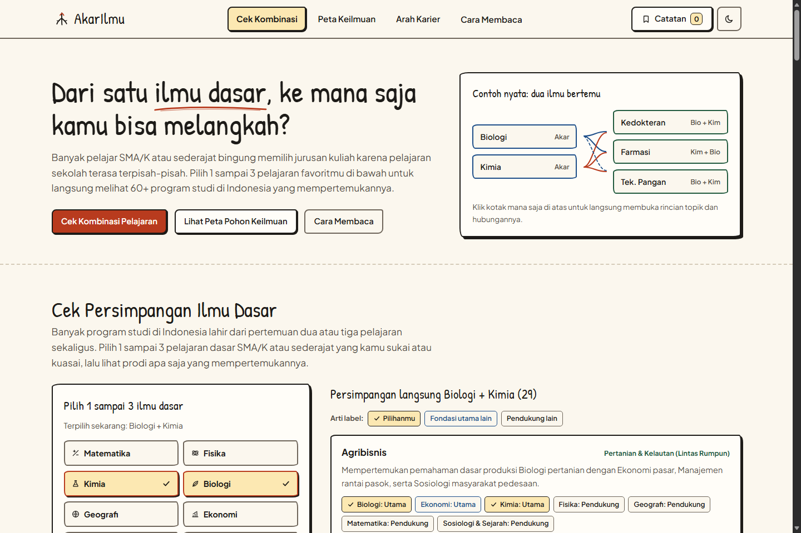
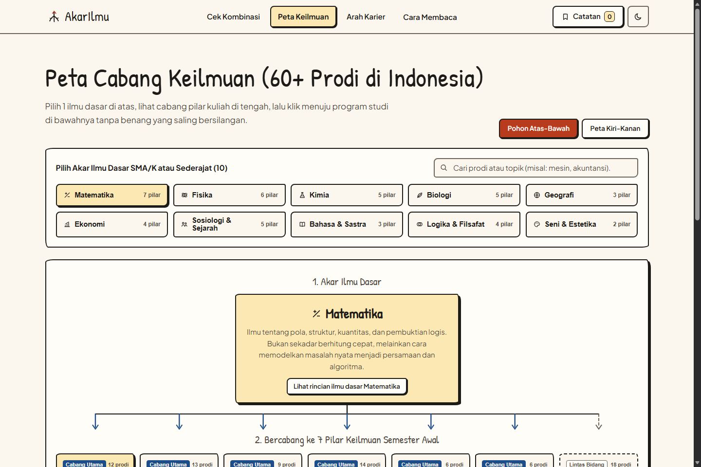
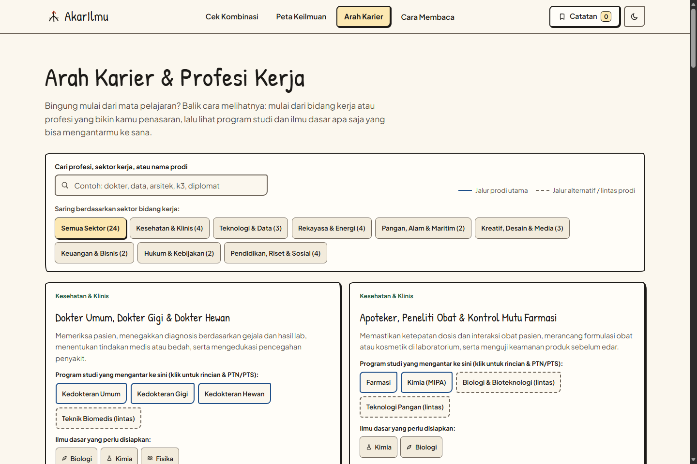
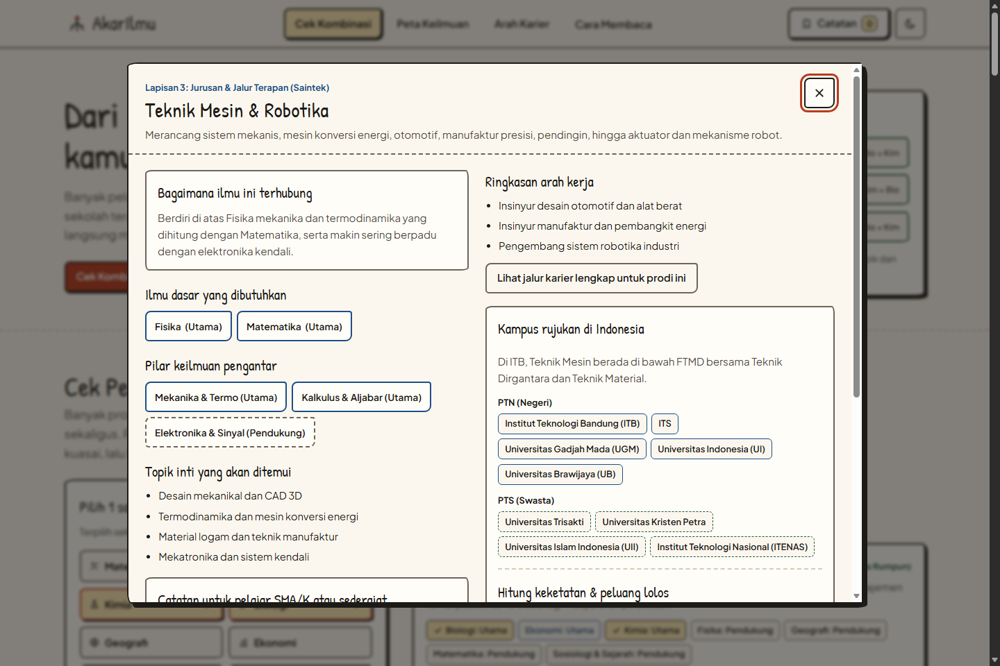

# Panduan Lengkap AkarIlmu (Untuk Pelajar, Guru BK, & Orang Tua)

**Kenali akarnya, lihat cabangnya.**
Akses langsung secara gratis di: **[https://akarilmu.vercel.app](https://akarilmu.vercel.app)** *(Tanpa daftar akun, tanpa iklan, bisa dibuka di HP maupun laptop).*

---

## 1. Kenapa AkarIlmu Dibuat?

Banyak pelajar **SMA/K atau sederajat** merasa bingung saat harus memilih jurusan kuliah karena adanya jarak antara apa yang mereka pelajari di sekolah dengan nama-nama program studi di kampus:

1. **Di sekolah**, pelajaran terbagi menjadi mata pelajaran dasar seperti *Matematika*, *Fisika*, *Kimia*, *Biologi*, *Ekonomi*, *Geografi*, *Sosiologi & Sejarah*, *Bahasa*, *Logika*, atau *Seni*.
2. **Di perguruan tinggi**, tiba-tiba pilihannya berubah menjadi puluhan nama jurusan spesifik seperti *Teknik Industri*, *Aktuaria*, *Teknologi Pangan*, *Bisnis Digital*, *Kesehatan Masyarakat*, *PWK (Planologi)*, atau *Teknik Biomedis*.
3. Akibatnya, banyak siswa memilih jurusan hanya berdasarkan tren atau ikut-ikutan teman tanpa tahu **pelajaran dasar apa yang menjadi fondasi jurusan tersebut** dan **apa yang sebenarnya dipelajari di semester awal**.

**AkarIlmu** hadir sebagai peta rujukan visual bergaya buku sketsa yang menjembatani **bangku sekolah -> bangku kuliah -> dunia kerja**.

---

## 2. Bagaimana Struktur Keilmuan di AkarIlmu Bekerja?

AkarIlmu memetakan hubungan keilmuan ke dalam **4 bagian yang saling terhubung**:

| Bagian | Jumlah | Penjelasan Singkat | Contoh di Dalam Aplikasi |
| :--- | :--- | :--- | :--- |
| **1. Akar Ilmu Dasar** | **10 Ilmu Dasar** | Pelajaran fundamental di bangku SMA/K atau sederajat yang menjadi fondasi awal. | Matematika, Fisika, Kimia, Biologi, Ekonomi, Geografi, Sosiologi & Sejarah, Bahasa & Sastra, Logika & Filsafat, Seni & Estetika. |
| **2. Pilar Keilmuan** | **16 Pilar Kuliah** | Jembatan ilmu pada tahun pertama kuliah tempat pelajaran sekolah mulai dipecah menjadi cabang spesifik. | Kalkulus & Aljabar, Statistika & Peluang, Mekanika & Termo, Biokimia & Sel, Algoritma & Komputasi, Ekonomi & Keuangan, Sistem & Industri. |
| **3. Program Studi** | **60+ Prodi (69 Prodi)** | Jurusan kuliah di Indonesia yang dikelompokkan ke dalam 9 rumpun keilmuan, lengkap dengan rujukan PTN/PTS. | Kesehatan, MIPA & Kebumian, Teknik & Rekayasa, Komputasi & Data, Pertanian & Kelautan, Arsitektur & Seni, Ekonomi & Bisnis, Hukum & Sosial, Bahasa & Pendidikan. |
| **4. Arah Karier** | **24 Jalur Profesi** | Gambaran profesi kerja lintas 8 sektor industri untuk menelusuri balik jurusan dan ilmu dasar yang dibutuhkan. | Dokter & Tenaga Klinis, Rekayasa Perangkat Lunak & AI, Analisis Keuangan & Aktuaria, Arsitek & Perancang Kota, Riset & Kebijakan Publik. |

---

## 3. Tiga Cara Menggunakan AkarIlmu (Pilih Sesuai Kondisimu)

Setiap pelajar punya titik berangkat yang berbeda. Kamu bisa memakai AkarIlmu dari **3 pintu masuk** berikut:

---

### Cara 1: Mulai dari "Cek Kombinasi" (Jika Kamu Punya 1 sampai 3 Pelajaran Favorit)

Cocok untuk pelajar yang berkata: *"Di sekolah aku lumayan suka Biologi sama Kimia (atau Matematika sama Ekonomi), kira-kira jurusan kuliah apa yang cocok buatku?"*

**Langkah pakainya:**
1. Buka halaman utama **[Cek Kombinasi](https://akarilmu.vercel.app/#kombinasi)**.
2. Di panel sebelah kiri (**Pilih 1 sampai 3 ilmu dasar**), klik 1 hingga 3 mata pelajaran yang paling kamu sukai atau kuasai. Kamu juga bisa menekan tombol **Contoh cepat** di bawahnya (seperti `Biologi + Kimia`, `Fisika + Matematika`, atau `Matematika + Ekonomi`).
3. Di panel sebelah kanan, AkarIlmu otomatis menyaring daftar program studi yang mempertemukan pelajaran pilihanmu:
   - **Persimpangan langsung**: Jurusan yang membutuhkan seluruh pelajaran yang kamu centang sekaligus.
   - **Penjelasan akademik**: Setiap kartu jurusan menjelaskan secara ringkas bagaimana pelajaran-pelajaran tersebut bertemu di bangku kuliah.
   - **Label warna**:
     - Kotak **`✓ Pilihanmu`**: Pelajaran yang sedang kamu pilih.
     - Kotak **`Fondasi utama lain`**: Pelajaran penting lain yang juga menjadi tumpuan utama di jurusan tersebut.
     - Kotak **`Pendukung lain`**: Ilmu pendamping yang akan ikut ditemui selama kuliah.

---

### Cara 2: Mulai dari "Peta Keilmuan" (Jika Ingin Melihat Pohon Percabangan Ilmu)

Cocok untuk pelajar yang berkata: *"Kalau aku berangkat dari satu pelajaran (misalnya Matematika atau Fisika), di kuliah nanti ilmunya bercabang ke mana saja?"*

Di halaman **[Peta Keilmuan](https://akarilmu.vercel.app/#peta)**, tersedia **2 mode tampilan** yang bisa kamu ganti lewat tombol di kanan atas:

1. **Mode `Pohon Atas-Bawah` (Rekomendasi untuk Fokus Bertahap)**:
   - **Tingkat 1 (Atas)**: Pilih salah satu dari **10 Akar Ilmu Dasar** (misalnya `Matematika`).
   - **Tingkat 2 (Tengah)**: Lihat garis pohon bercabang turun ke deretan **Pilar Keilmuan Semester Awal** (misalnya dari *Matematika* turun ke *Kalkulus & Aljabar*, *Statistika & Peluang*, *Algoritma & Komputasi*, hingga *Ekonomi & Keuangan*).
   - **Tingkat 3 (Bawah)**: Klik salah satu kotak Pilar di tengah, maka daftar **Program Studi** yang tumbuh dari pilar tersebut langsung terbuka rapi di bawahnya tanpa garis yang saling bertabrakan.
2. **Mode `Peta Kiri-Kanan` (Bagan 3 Kolom Menyeluruh)**:
   - Menampilkan seluruh 10 Ilmu Dasar di kolom kiri, 16 Pilar di kolom tengah, dan 69 Program Studi di kolom kanan dalam satu kanvas besar.

---

### Cara 3: Mulai dari "Arah Karier" (Jika Sudah Punya Bayangan Cita-cita Profesi)

Cocok untuk pelajar yang berkata: *"Aku belum yakin suka pelajaran apa, tapi aku penasaran pengen kerja di bidang Data, Keuangan, Kesehatan, atau Desain. Harus masuk jurusan apa ya?"*

**Langkah pakainya:**
1. Buka tab **[Arah Karier](https://akarilmu.vercel.app/#karier)**.
2. Saring berdasarkan **8 sektor bidang kerja** (atau ketik nama profesi di kotak pencarian, misalnya `dokter`, `data`, `akuntan`, `arsitek`, `diplomat`).
3. Pada setiap kartu karier, kamu bisa membaca:
   - **Gambaran kerja harian**: Apa yang sebenarnya dikerjakan profesi tersebut sehari-hari.
   - **Program studi pengantar**: Dibagi menjadi **Jalur prodi utama** (kotak garis utuh) dan **Jalur alternatif / lintas prodi** (kotak garis putus-putus).
   - **Ilmu dasar yang perlu disiapkan**: Pelajaran SMA/K apa yang menjadi bekal utamanya.
   - **Catatan realitas lapangan**: Informasi jujur mengenai syarat dunia kerja (misalnya kewajiban pendidikan profesi/sertifikasi untuk dokter, apoteker, dan akuntan publik, atau pentingnya portofolio nyata untuk bidang teknologi dan kreatif).

---

## 4. Membaca Pop-up Rincian Prodi, Rujukan PTN/PTS & Kalkulator Keketatan

Di halaman mana pun kamu berada (*Cek Kombinasi*, *Peta Keilmuan*, maupun *Arah Karier*), **klik nama program studi mana saja** untuk membuka **Pop-up Rincian Landscape 2 Kolom** di tengah layar:

Di dalam pop-up rincian ini terdapat:

1. **Kolom Kiri (Profil Akademik & Keilmuan)**:
   - **Bagaimana ilmu ini terhubung**: Penjelasan mengapa ilmu-ilmu dasar tersebut saling berpadu di jurusan ini.
   - **Ilmu dasar & Pilar keilmuan pengantar**: Tombol interaktif untuk melihat prasyarat utama dan pendukung.
   - **Topik inti yang akan ditemui**: Gambaran mata kuliah atau praktikum utama selama kuliah.
   - **Catatan untuk pelajar SMA/K atau sederajat**: Tips praktis sebelum memilih jurusan tersebut.
2. **Kolom Kanan (Arah Kerja, Kampus PTN/PTS, & Simulasi Keketatan Kursi)**:
   - **Ringkasan arah kerja**: Contoh profesi lulusan beserta tombol pintas ke halaman *Arah Karier*.
   - **Contoh Kampus PTN & PTS di Indonesia**: Daftar referensi Perguruan Tinggi Negeri (PTN) dan Perguruan Tinggi Swasta (PTS) yang menyelenggarakan prodi tersebut, dilengkapi tautan verifikasi resmi ke **SNPMB (`snpmb.id`)** dan **PDDikti (`pddikti.kemdiktisaintek.go.id`)**.
   - **Kalkulator Simulasi Keketatan Kursi (SNBP / SNBT)**:
     Masukkan angka *Daya Tampung Kursi* dan *Jumlah Peminat Tahun Lalu* dari portal SNPMB untuk menghitung persentase peluang kursi (misal `4,00%` atau rasio `1 : 25`) serta kategori tingkat persaingannya secara instan.
   - **Simpan di Catatan Belajarmu**: Tandai prodi dengan status `Tertarik`, `Sedang dipelajari`, atau `Sudah paham dasar`. Catatanmu tersimpan otomatis di browser (bisa dibuka lewat tombol **Catatan** di pojok kanan atas) tanpa perlu login.

---

## 5. Tips Memanfaatkan AkarIlmu untuk Diskusi

* **Untuk Pelajar SMA/K atau Sederajat**:
  Pilih 3 sampai 5 prodi yang menarik perhatianmu, klik tombol **`Tertarik`** di dalam pop-up rinciannya, lalu buka menu **Catatan** di kanan atas untuk membandingkan opsi jurusan pilihan pertama dan pilihan kedua.
* **Untuk Guru BK & Pendamping Sekolah**:
  Gunakan halaman **Cek Kombinasi** saat sesi konseling siswa untuk membantu siswa yang hanya tahu nilai rapor terbaiknya (misal kuat di *Matematika + Geografi* atau *Biologi + Ekonomi*), lalu tunjukkan **Pop-up Rincian Prodi** agar siswa memahami topik kuliah dan rasio persaingan kursinya.
* **Untuk Orang Tua**:
  Gunakan halaman **Arah Karier** dan **Pop-up Rincian Prodi** untuk berdiskusi secara objektif bersama anak mengenai hubungan antara minat pelajaran mereka di sekolah, pilihan kampus PTN/PTS, dan prospek bidang kerjanya.
* **Nyaman Dibaca Siang maupun Malam**:
  Klik ikon **Bulan / Matahari** di pojok kanan atas untuk berganti antara **Mode Terang (*Warm Sketchbook*)** dan **Mode Gelap (*Catppuccin Mocha*)** yang dirancang lembut di mata, serta klik menu **Cara Membaca** kapan saja untuk membuka ringkasan panduan cepat berformat 2 kolom.

---

## 6. Disclaimer & Masukan

**Disclaimer:** Website AkarIlmu dibuat dengan bantuan AI berdasarkan referensi umum program studi di Indonesia dan berfungsi sebagai **gambaran awal / kompas eksplorasi** (bukan acuan resmi kampus atau panitia seleksi nasional). Selalu verifikasi kurikulum, akreditasi, dan daya tampung terbaru melalui laman resmi masing-masing perguruan tinggi, [PDDikti](https://pddikti.kemdiktisaintek.go.id/), serta [Portal Resmi SNPMB](https://snpmb.id/).

Menemukan data yang perlu dikoreksi, ingin mengusulkan tambahan program studi/kampus, atau ingin menyampaikan apresiasi? Klik tombol **"Kirim Masukan / Apresiasi"** di bagian bawah website **[akarilmu.vercel.app](https://akarilmu.vercel.app)**.

Eksperimen keilmuan terbuka oleh **[MentayaSandbox](https://mentayasandbox.vercel.app/)**.
