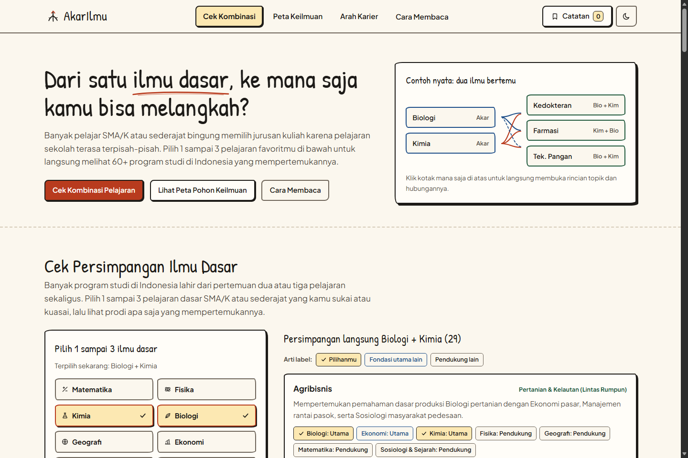
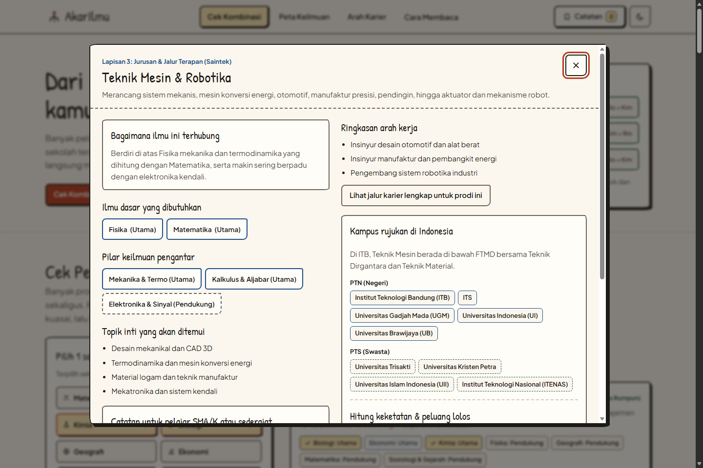

# AkarIlmu

**Kenali akarnya, lihat cabangnya.**

Peta referensi keilmuan interaktif bergaya buku sketsa untuk pelajar **SMA/K atau sederajat** di Indonesia. Website ini membantu memperlihatkan bagaimana **10 ilmu dasar** di bangku sekolah saling terhubung menuju **16 pilar keilmuan kuliah**, **60+ program studi (69 prodi lintas 9 rumpun)** di perguruan tinggi Indonesia, hingga **24 jalur karier** di dunia kerja.

* **Website Langsung (Gratis, Tanpa Login):** [https://akarilmu.vercel.app](https://akarilmu.vercel.app)
* **Panduan Pengguna Lengkap (Untuk Pelajar, Guru BK, & Orang Tua):** [Baca PANDUAN.md](./PANDUAN.md)

---

## Mengapa AkarIlmu?

Banyak pelajar SMA/K atau sederajat bingung memilih jurusan kuliah karena pelajaran di sekolah (*Matematika, Fisika, Kimia, Biologi, Ekonomi, Bahasa, dll.*) terasa terpisah dari puluhan nama program studi di perguruan tinggi (*Aktuaria, Teknik Industri, Teknologi Pangan, Bisnis Digital, Planologi, dll.*).

**AkarIlmu** menjawab kebingungan tersebut melalui **3 pintu eksplorasi** yang bisa dipilih sesuai kondisi masing-masing pelajar:

1. **Berangkat dari Pelajaran Favorit di Sekolah (`#kombinasi` · Cek Kombinasi)**
   Pilih 1 sampai 3 pelajaran dasar yang paling kamu sukai, lalu lihat daftar jurusan kuliah yang lahir dari pertemuan pelajaran-pelajaran tersebut beserta alasan keilmuannya.
2. **Berangkat dari Pohon Cabang Ilmu (`#peta` · Peta Keilmuan 2 Mode)**
   Lihat bagaimana 1 mata pelajaran sekolah bercabang ke pilar-pilar mata kuliah tahun pertama hingga ke program studi melalui mode **`Pohon Atas-Bawah`** (fokus bertahap tanpa garis bersilangan) atau **`Peta Kiri-Kanan`** (bagan 3 kolom menyeluruh).
3. **Berangkat dari Cita-cita Profesi (`#karier` · Arah Karier)**
   Mulai dari 24 jalur profesi di 8 sektor kerja, baca gambaran tugas harian dan catatan realitas lapangannya, lalu lacak balik program studi serta ilmu dasar yang perlu disiapkan.

---

## Pratinjau Visual & Cara Kerja

### 1. Halaman Utama: Cek Kombinasi Pelajaran (`#kombinasi`)
Pilih 1 sampai 3 pelajaran dasar SMA/K atau sederajat di panel kiri untuk menyaring program studi yang mempertemukan pelajaran tersebut, lengkap dengan label **`✓ Pilihanmu`**, **`Fondasi utama lain`**, dan **`Pendukung lain`**.



### 2. Peta Cabang Keilmuan: Pohon Atas-Bawah & Peta Kiri-Kanan (`#peta`)
Telusuri alur **1. Akar Ilmu Dasar -> 2. Pilar Keilmuan Semester Awal -> 3. Cabang Program Studi** secara terstruktur dari atas ke bawah, atau beralih ke bagan 3 kolom kiri-ke-kanan.


### 3. Arah Karier & Profesi Kerja (`#karier`)
Saring profesi berdasarkan 8 sektor kerja untuk melihat program studi jalur utama, jalur alternatif lintas bidang, ilmu dasar prasyarat, serta catatan realitas dunia kerja.


### 4. Pop-up Rincian Prodi, Rujukan PTN/PTS & Kalkulator Keketatan Kursi
Klik kotak program studi mana saja untuk membuka kartu pop-up *landscape* 2 kolom di tengah layar yang memuat penjelasan hubungan ilmu, topik inti kuliah, contoh kampus **PTN & PTS di Indonesia**, serta **Kalkulator Simulasi Keketatan Kursi (Daya Tampung vs Peminat)** untuk SNBP/SNBT.



---

## Cakupan Data Keilmuan

* **10 Ilmu Dasar (SMA/K atau Sederajat)**:
  Matematika, Fisika, Kimia, Biologi, Geografi, Ekonomi, Sosiologi & Sejarah, Bahasa & Sastra, Logika & Filsafat, Seni & Estetika.
* **16 Pilar Keilmuan Semester Awal**:
  Kalkulus & Aljabar, Statistika & Peluang, Algoritma & Komputasi, Mekanika & Termo, Elektronika & Sinyal, Kimia & Material, Biokimia & Sel, Anatomi & Kesehatan, Ekologi & Hayati, Kebumian & Spasial, Ekonomi & Keuangan, Sistem & Industri, Masyarakat & Budaya, Hukum & Kebijakan, Bahasa & Komunikasi, Desain & Estetika.
* **69 Program Studi Lintas 9 Rumpun Keilmuan**:
  1. Kesehatan
  2. MIPA & Kebumian
  3. Teknik & Rekayasa
  4. Komputasi & Data
  5. Pertanian & Kelautan
  6. Arsitektur & Seni
  7. Ekonomi & Bisnis (Manajemen, Akuntansi, Ilmu Ekonomi, Bisnis Digital, Keuangan & Perbankan, Ekonomi Syariah, Kewirausahaan, Perpajakan, Logistik, Administrasi Bisnis)
  8. Hukum & Sosial
  9. Bahasa & Pendidikan
* **24 Jalur Karier Lintas 8 Sektor Kerja**:
  Kesehatan & Klinis, Teknologi & Data, Rekayasa & Energi, Pangan/Alam & Maritim, Kreatif/Desain & Media, Keuangan & Bisnis, Hukum & Kebijakan, serta Pendidikan/Riset & Sosial.

---

## Dokumentasi Teknis (Bagi Pengembang)

### Teknologi yang Digunakan
* React 19 + TypeScript + Vite 6
* CSS Custom Design Tokens (tema terang *Warm Sketchbook* dan mode gelap 3-warna berbasis *Catppuccin Mocha*, tanpa ketergantungan framework CSS eksternal)
* Visualisasi garis pohon SVG kustom dengan pengukuran koordinat DOM presisi
* Vercel Serverless Function (`api/feedback.js`) + `@vercel/functions`

### Menjalankan Secara Lokal

```bash
npm install
npm run dev
```

Membangun bundel produksi:

```bash
npm run build
```

---

## Disclaimer & Kredit

**Disclaimer:** Website ini dibuat dengan bantuan AI berdasarkan referensi umum program studi di Indonesia dan hanya berfungsi sebagai gambaran awal (bukan acuan resmi kampus atau panitia seleksi). Selalu verifikasi informasi resmi melalui portal [SNPMB](https://snpmb.id/), [PDDikti](https://pddikti.kemdiktisaintek.go.id/), dan situs perguruan tinggi tujuan. Menemukan kekeliruan atau punya masukan? Silakan kirim melalui tombol **Kirim Masukan / Apresiasi** di dalam aplikasi.

Eksperimen terbuka oleh [MentayaSandbox](https://mentayasandbox.vercel.app/).
