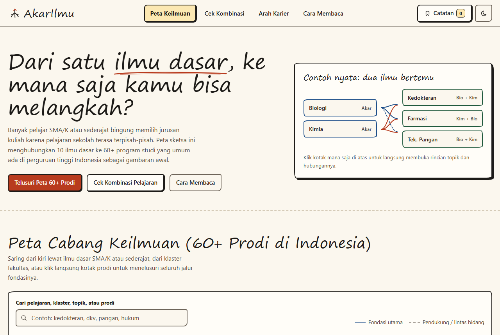

# AkarIlmu

**Kenali akarnya, lihat cabangnya.**

Peta referensi keilmuan interaktif bergaya buku sketsa untuk pelajar SMA/K atau sederajat di Indonesia. Website ini membantu memperlihatkan bagaimana 10 ilmu dasar di sekolah saling terhubung menuju 16 pilar keilmuan kuliah, 60+ program studi di perguruan tinggi Indonesia, hingga arah profesi kerjanya.

**Demo Langsung (Vercel):** [https://akarilmu.vercel.app](https://akarilmu.vercel.app)

---

## Pratinjau Tampilan

### 1. Peta Keilmuan (10 Ilmu Dasar -> 16 Pilar -> 60+ Prodi di Indonesia)



### 2. Cek Kombinasi Pelajaran (Persimpangan 1 sampai 3 Ilmu Dasar)


### 3. Arah Karier & Profesi Kerja (Telusur Balik dari Profesi ke Prodi)


---

## Fitur Utama

- **Peta Cabang Keilmuan (`#peta`)**: Menelusuri hubungan 10 ilmu dasar (Matematika, Fisika, Kimia, Biologi, Geografi, Ekonomi, Sosiologi & Sejarah, Bahasa & Sastra, Logika & Filsafat, Seni & Estetika) ke 16 pilar kuliah dan 64 program studi lintas 9 klaster fakultas di Indonesia.
- **Cek Persimpangan Ilmu (`#kombinasi`)**: Memilih 1 sampai 3 pelajaran favorit sekaligus untuk melihat jurusan apa saja yang mempertemukannya (misalnya Biologi + Kimia, Fisika + Matematika, atau Bahasa + Matematika).
- **Arah Karier (`#karier`)**: Memetakan 24 jalur karier lintas 8 sektor kerja beserta aktivitas harian, prodi jalur utama maupun lintas prodi, ilmu dasar yang perlu disiapkan, dan catatan realitas lapangan (seperti syarat pendidikan profesi atau portofolio).
- **Rincian Prodi, Rujukan PTN/PTS & Kalkulator Keketatan**: Setiap program studi dilengkapi topik inti, contoh PTN dan PTS rujukan di Indonesia, tautan ke portal resmi `snpmb.id`, serta kalkulator rasio keketatan (Daya Tampung dibanding Jumlah Peminat).
- **Catatan Belajar Lokal**: Menandai status bidang (`Tertarik`, `Sedang dipelajari`, `Sudah paham dasar`) yang tersimpan langsung di `localStorage` tanpa perlu akun.
- **Mode Terang & Gelap + Responsif Ponsel**: Tema kertas sketsa krem dan mode gelap *Midnight Sketchbook*, dilengkapi tab 3 lapis, filter lipat, dan bilah navigasi bawah khusus layar smartphone.
- **Formulir Masukan & Apresiasi**: Pop-up pengiriman koreksi data atau pesan semangat melalui endpoint `/api/feedback`.

---

## Teknologi

- React 19 + TypeScript + Vite 6
- CSS custom design tokens (tema sketsa terang & gelap, tanpa framework CSS berat)
- Ikon dan garis kurva penghubung SVG kustom
- Vercel Serverless Function (`api/feedback.js`) + `@vercel/functions`

---

## Menjalankan Secara Lokal

```bash
npm install
npm run dev
```

Untuk membangun bundel produksi:

```bash
npm run build
```

### Variabel Lingkungan Opsional (Pengiriman Email `/api/feedback`)

Jika ingin mengirim email masukan langsung dari server Vercel via Resend atau Web3Forms, atur variabel berikut di Project Settings Vercel:

- `FEEDBACK_TO_EMAIL` (default: `mentayasandbox@gmail.com`)
- `RESEND_API_KEY` (opsional, untuk pengiriman via Resend)
- `WEB3FORMS_ACCESS_KEY` (opsional, untuk pengiriman via Web3Forms)

Jika keduanya tidak diatur, formulir otomatis menggunakan penerusan AJAX melalui browser.

---

## Disclaimer & Kredit

**Disclaimer:** Website ini dibuat dengan bantuan AI berdasarkan referensi umum program studi di Indonesia dan hanya berfungsi sebagai gambaran awal (bukan acuan resmi kampus atau panitia seleksi). Menemukan kekeliruan atau punya masukan? Silakan kirim DM atau coret-coret di kolom komentar, ya!

Eksperimen terbuka oleh [MentayaSandbox](https://mentayasandbox.vercel.app/).
