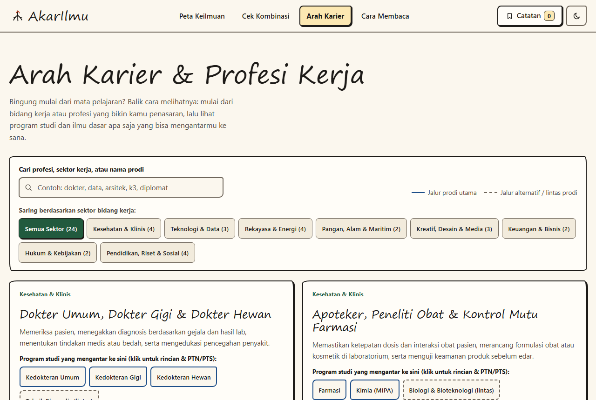

# AkarIlmu

**Kenali akarnya, lihat cabangnya.**

Peta referensi keilmuan interaktif bergaya buku sketsa untuk pelajar SMA/K atau sederajat di Indonesia. Website ini membantu memperlihatkan bagaimana 10 ilmu dasar di sekolah saling terhubung menuju 16 pilar keilmuan kuliah, 60+ program studi di perguruan tinggi Indonesia, hingga arah profesi kerjanya.

**Demo Langsung (Vercel):** [https://akarilmu.vercel.app](https://akarilmu.vercel.app)

---

## Pratinjau Tampilan

### 1. Cek Kombinasi Pelajaran (Halaman Utama: Persimpangan 1 sampai 3 Ilmu Dasar)


### 2. Peta Keilmuan (Mode Pohon Atas-Bawah & Peta Kiri-Kanan: 10 Ilmu Dasar -> 16 Pilar -> 60+ Prodi)


### 3. Arah Karier & Profesi Kerja (Telusur Balik dari 24 Jalur Profesi ke Prodi)



---

## Fitur Utama

- **Cek Persimpangan Ilmu (`#kombinasi` · Halaman Utama)**: Pengunjung dapat langsung memilih 1 sampai 3 pelajaran favorit SMA/K atau sederajat untuk melihat program studi apa saja yang mempertemukannya (misalnya `Biologi + Kimia`, `Fisika + Matematika`, `Matematika + Ekonomi`, atau `Bahasa + Matematika`) lengkap dengan alasan keilmuannya.
- **Peta Cabang Keilmuan 2 Mode (`#peta`)**:
  - **Mode `Pohon Atas-Bawah`**: Menelusuri 1 akar ilmu dasar di atas, bercabang turun ke deretan pilar kuliah semester awal di tengah, lalu turun ke gugus program studi di bawahnya tanpa garis yang saling bersilangan.
  - **Mode `Peta Kiri-Kanan`**: Bagan 3 kolom menyeluruh untuk melihat hubungan 10 ilmu dasar, 16 pilar keilmuan, dan 69 program studi lintas 9 rumpun keilmuan (termasuk rumpun Ekonomi & Bisnis).
- **Arah Karier (`#karier`)**: Memetakan 24 jalur karier lintas 8 sektor kerja beserta aktivitas harian, prodi jalur utama maupun lintas bidang, ilmu dasar yang perlu disiapkan, dan catatan realitas lapangan.
- **Pop-up Rincian Landscape, Rujukan PTN/PTS & Kalkulator Keketatan**: Klik kartu program studi mana saja untuk membuka pop-up kartu *landscape* 2 kolom di tengah layar (otomatis menyesuaikan menjadi 1 kolom di layar ponsel) yang memuat topik inti kuliah, contoh PTN dan PTS rujukan di Indonesia, tautan ke `snpmb.id`, serta kalkulator simulasi rasio keketatan kursi (Daya Tampung dibanding Jumlah Peminat).
- **Catatan Belajar Lokal**: Menandai status bidang (`Tertarik`, `Sedang dipelajari`, `Sudah paham dasar`) yang tersimpan langsung di `localStorage` browser tanpa perlu akun.
- **Mode Terang & Gelap + Responsif Ponsel**: Tema kertas sketsa krem (*Warm Sketchbook*) dan mode gelap (*Midnight Sketchbook*), dilengkapi bilah navigasi bawah khusus layar ponsel.
- **Formulir Masukan & Apresiasi**: Pop-up pengiriman koreksi data atau pesan semangat melalui endpoint `/api/feedback`.

---

## Teknologi

- React 19 + TypeScript + Vite 6
- CSS custom design tokens (tema sketsa terang & gelap, tanpa framework CSS berat)
- Ikon dan garis percabangan pohon SVG kustom dengan pengukuran koordinat DOM presisi
- Vercel Serverless Function (`api/feedback.js`) + `@vercel/functions`

---

## Menjalankan Secara Lokal

```bash
npm install
npm run dev
```

Untuk membangun bundel produksi:

```bash
npm run build
```

### Variabel Lingkungan Opsional (Pengiriman Email `/api/feedback`)

Jika ingin mengirim email masukan langsung dari server Vercel via Resend atau Web3Forms, atur variabel berikut di Project Settings Vercel:

- `FEEDBACK_TO_EMAIL` (default: `mentayasandbox@gmail.com`)
- `RESEND_API_KEY` (opsional, untuk pengiriman via Resend)
- `WEB3FORMS_ACCESS_KEY` (opsional, untuk pengiriman via Web3Forms)

Jika keduanya tidak diatur, formulir otomatis menggunakan penerusan AJAX melalui browser.

---

## Disclaimer & Kredit

**Disclaimer:** Website ini dibuat dengan bantuan AI berdasarkan referensi umum program studi di Indonesia dan hanya berfungsi sebagai gambaran awal (bukan acuan resmi kampus atau panitia seleksi). Menemukan kekeliruan atau punya masukan? Silakan kirim DM atau coret-coret di kolom komentar, ya!

Eksperimen terbuka oleh [MentayaSandbox](https://mentayasandbox.vercel.app/).
